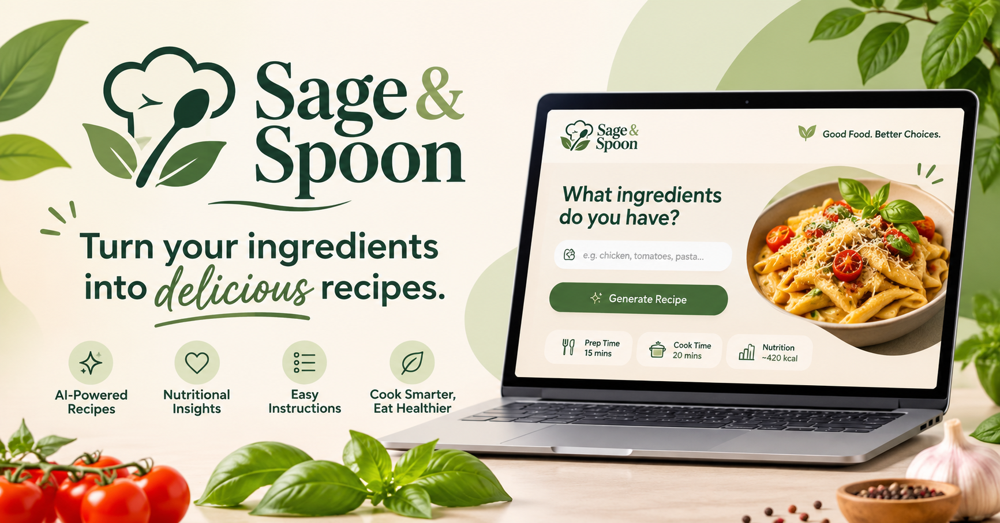
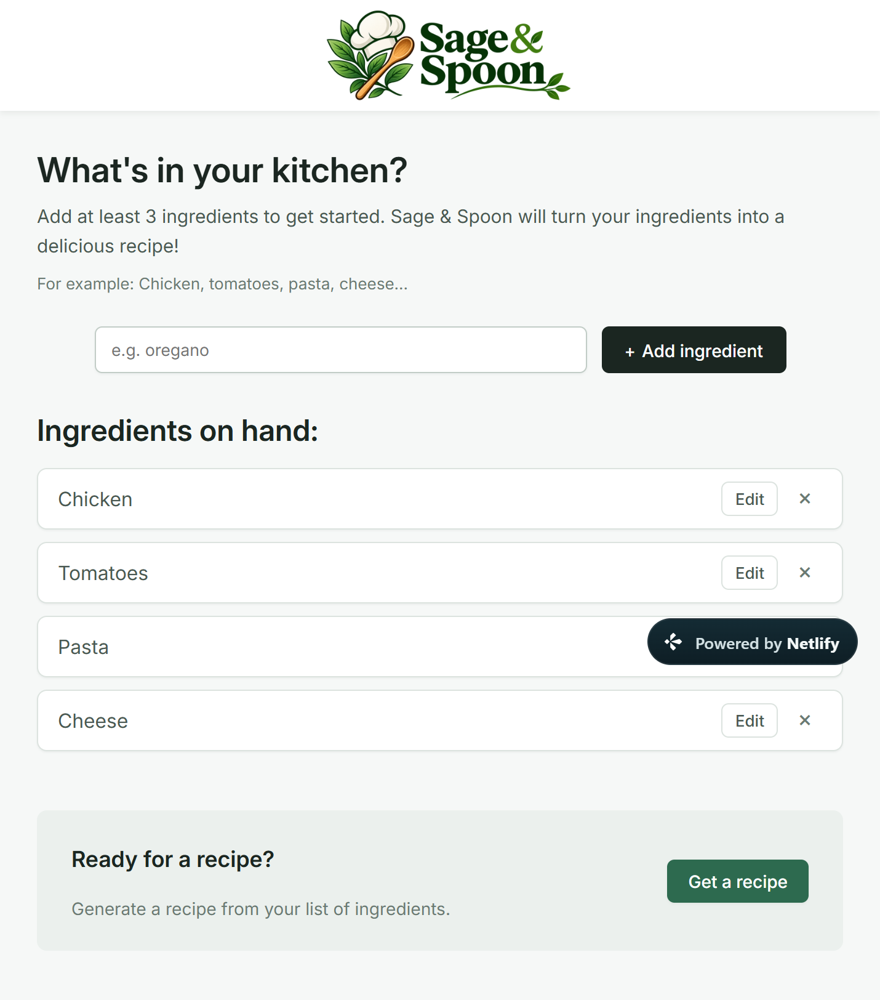
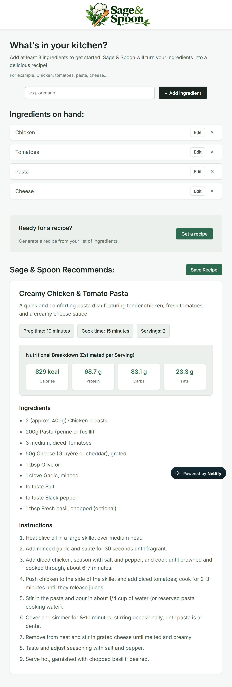
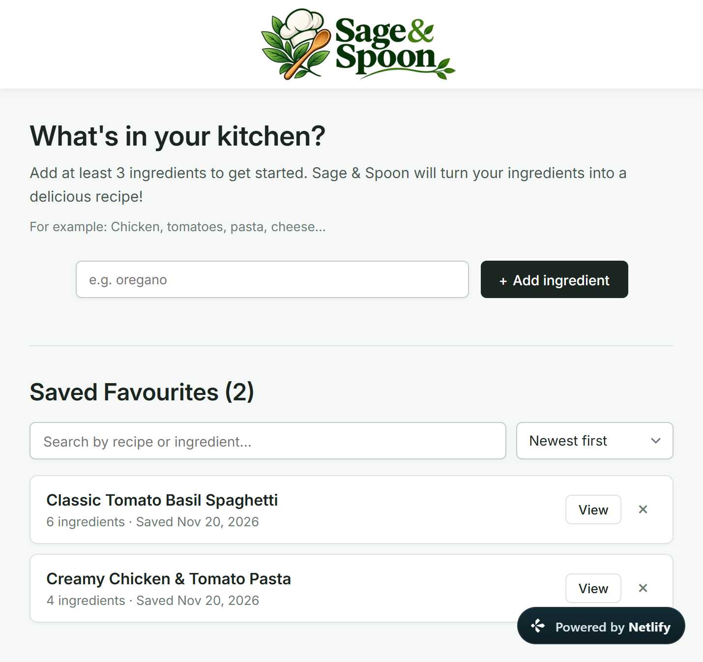

# Sage & Spoon 🌿

<p align="center">
  
</p>

<h3 align="center">
  Turn your ingredients into delicious recipes.
</h3>

<p align="center">
  An AI-powered recipe generation application that helps users
  turn their available ingredients into practical recipe ideas.
</p>

<p align="center">
  <a href="https://sage-and-spoon.netlify.app/">
    <strong>🌐 Live Demo</strong>
  </a>
  &nbsp; | &nbsp;
  <a href="https://github.com/AshfakAhamed07/sage-and-spoon">
    <strong>📂 GitHub Repository</strong>
  </a>
</p>

---

Sage & Spoon is a full-stack application featuring a React frontend
and a custom Express.js backend.

Users can manage ingredients, generate structured recipes using
the Groq API, view nutritional information through Spoonacular,
and save, search, and organise their favourite recipes.


## ✨ Features

### Ingredient Management
- Add ingredients to the available ingredient list.
- Edit existing ingredients.
- Remove ingredients.
- Prevent empty and duplicate ingredient entries.
- Validate ingredient input.

### AI Recipe Generation
- Generate recipe recommendations based on available ingredients.
- Use the Groq API to generate structured recipe data.
- Display recipe titles and descriptions.
- Show ingredient quantities and cooking instructions.
- Display preparation time, cooking time, and serving information.

### Nutritional Analysis
- Integrate the Spoonacular API for recipe nutritional analysis.
- Display estimated nutritional information per serving.
- Show calories, protein, carbohydrates, and fat.
- Handle nutritional analysis failures without preventing recipe generation.

### Saved Favourites
- Save generated recipes to favourites.
- View previously saved recipes.
- Restore saved recipes, including their nutritional information.
- Delete saved favourites with confirmation.
- Persist favourites using browser `localStorage`.

### Search and Sorting
- Search saved recipes by recipe title or ingredient.
- Sort saved recipes by newest or oldest.
- Display the number of matching results alongside the total number of favourites.
- Handle empty search results.

### User Experience
- Provide first-time user guidance explaining how to get started.
- Display the minimum ingredient requirement and dynamically show how many more ingredients are needed.
- Enable recipe generation once at least three ingredients have been added.
- Display loading feedback during recipe generation.
- Provide error feedback when requests fail.
- Automatically scroll to the generated recipe.
- Responsive layouts for different screen sizes.


## 🛠️ Technology Stack

| Category | Technologies |
|---|---|
| Frontend | React, JavaScript, HTML |
| Build Tool | Vite |
| Styling | CSS |
| Backend | Node.js, Express.js |
| AI Integration | Groq API |
| Nutritional Analysis | Spoonacular API |
| Data Persistence | Browser localStorage |
| Deployment | Netlify, Railway |
| Version Control | Git, GitHub |

## 🏗️ Application Architecture

Sage & Spoon uses a React frontend connected to a custom Express.js backend.

The frontend handles the user interface, ingredient management, recipe presentation, and saved favourites. The backend handles request validation and communication with external APIs, keeping API credentials out of the frontend source code.


## 📸 Application Screenshots

### Ingredient Management

Add, edit, and remove ingredients before generating a recipe.



### Generated Recipe & Nutritional Analysis

Generate recipes using available ingredients and view nutritional information, including calories, protein, carbohydrates, and fat.



### Saved Favourites

Save recipes, search your collection, sort saved recipes, and revisit previously generated meals.



### Recipe Generation Flow

1. The user manages their available ingredients in the React application.
2. The frontend sends the ingredient list to the Express backend.
3. The backend validates the incoming request.
4. The Groq API generates structured recipe data using JSON Schema.
5. The backend sends the generated recipe to Spoonacular for nutritional analysis.
6. The backend returns the recipe and available nutritional information to the frontend.
7. React displays the generated recipe and its nutritional breakdown.

**External API responsibilities:**

- **Groq API:** Generates structured recipe data.
- **Spoonacular API:** Analyses the generated recipe and provides nutritional information.

Nutritional analysis is handled independently, so a Spoonacular failure does not prevent an otherwise successful recipe generation.

### Deployment Architecture

The application is deployed using separate frontend and backend services.

- **Frontend:** Hosted on Netlify.
- **Backend:** Hosted on Railway.
- **API communication:** The frontend communicates with the backend through HTTP requests.
- **CORS:** Backend requests are restricted to configured frontend origins.
- **Environment variables:** API credentials are stored in the backend deployment environment.

## 📁 Project Structure

```text
sage-and-spoon/
├── components/
│   ├── ClaudeRecipe.jsx
│   ├── Header.jsx
│   ├── IngredientsList.jsx
│   ├── RecipeGenerator.jsx
│   └── SavedRecipes.jsx
├── images/
│   └── sage-and-spoon-logo.png
├── public/
│   └── images/
│       ├── sage-and-spoon-logo.png
│       └── sage-and-spoon-preview.png
├── server/
│   ├── services/
│   │   └── nutrition.js
│   ├── index.js
│   ├── package.json
│   └── .env.example
├── utils/
│   └── nutrition.js
├── ai.js
├── App.jsx
├── index.css
├── index.html
├── index.jsx
├── vite.config.mjs
├── .env.example
├── package.json
└── README.md
```

*The structure highlights the main application files; other configuration and dependency files are omitted for clarity.*

## 🚀 Getting Started

### Prerequisites

- Node.js 20 or later
- npm
- A Groq API key
- A Spoonacular API key

### 1. Clone the repository

Using SSH:

```bash
git clone git@github.com:AshfakAhamed07/sage-and-spoon.git
cd sage-and-spoon
```

Alternatively, clone using HTTPS:

```bash
git clone https://github.com/AshfakAhamed07/sage-and-spoon.git
cd sage-and-spoon
```

### 2. Install frontend dependencies

From the project root:

```bash
npm install
```

### 3. Install backend dependencies

```bash
cd server
npm install
```

### 4. Configure environment variables

Create a `.env` file inside the `server` directory using the provided `.env.example` as a reference.

```env
GROQ_API_KEY=your_groq_api_key
SPOONACULAR_API_KEY=your_spoonacular_api_key
PORT=3001
```

Next, create a `.env` file in the project root for the frontend:

```env
VITE_API_URL=http://localhost:3001
```

Replace the placeholder API keys with your own credentials.

**Important:** Never commit API keys or `.env` files to version control.

### 5. Start the backend server

From the `server` directory:

```bash
npm run dev
```

The backend runs on port `3001` during local development.

### 6. Start the frontend development server

Open a second terminal, navigate to the project root, and run:

```bash
npm run dev
```

Open the local development URL provided by Vite in your browser.

Both the frontend and backend must be running for recipe generation and nutritional analysis to work.

## 🔐 Environment Variables

The application uses environment variables to configure API communication and protect sensitive credentials.

| Variable | Location | Description |
|---|---|---|
| `VITE_API_URL` | Frontend | Backend API base URL |
| `GROQ_API_KEY` | Backend | API key used for Groq recipe generation |
| `SPOONACULAR_API_KEY` | Backend | API key used for nutritional analysis |
| `PORT` | Backend | Server port; Railway provides this automatically in production |
| `FRONTEND_URL` | Backend deployment | Allowed frontend origin for CORS |

The frontend's `VITE_API_URL` is used to communicate with the backend. In production, it points to the deployed Railway service.

Keep API credentials on the backend. Never expose secret API keys through frontend environment variables or commit them to GitHub.

## ☁️ Deployment

Sage & Spoon is deployed using:

| Service | Platform |
|---|---|
| React frontend | [Netlify](https://www.netlify.com/) |
| Express backend | [Railway](https://railway.com/) |

**Live application:** [https://sage-and-spoon.netlify.app/](https://sage-and-spoon.netlify.app/)

The frontend is built using Vite with `npm run build`, and the generated `dist` directory is deployed to Netlify.

The Express backend is deployed separately on Railway and provides the API endpoints used by the frontend.

## 📚 Key Concepts and Implementation

This project demonstrates practical application of:

- Component-based architecture.
- React state management and hooks.
- Props and component communication.
- Forms and event handling.
- Conditional rendering and list rendering.
- Asynchronous JavaScript and API requests.
- Frontend and backend communication.
- REST API development using Express.
- Request validation and error handling.
- External API integration.
- Structured JSON responses and JSON Schema.
- Environment variable management.
- CORS configuration.
- Persistent browser storage using `localStorage`.
- Production builds and deployment.
- Git version control and incremental development.

## 🔮 Future Improvements

Potential enhancements include:

- Automated frontend and backend testing.
- Improved accessibility and user experience.
- Additional recipe filtering and discovery features.
- Further improvements to data persistence and reliability.
- Additional backend validation and security enhancements.

## 👨‍💻 Author

**Ashfak Ahamed**

- GitHub: [AshfakAhamed07](https://github.com/AshfakAhamed07)